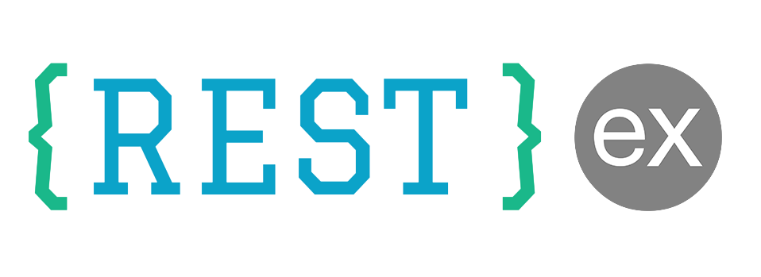

# restex

Simple and minimalist API wrapper based on top of Expressjs with support for mongoose & sequelizejs, now with ES6 support!

## Requirements

You need **Node.js >=14.0.0** installed and you'll need MongoDB installed and running for MongoDB support, or a SQL database for Sequelize support.

## Installation

```bash
npm install restex
```

## Usage

### Initialize restex using MongoDB database (mongoose)

```javascript
import express from 'express';
import RestEx from 'restex';
import path from 'path';
import { fileURLToPath } from 'url';

const __filename = fileURLToPath(import.meta.url);
const __dirname = path.dirname(__filename);

const app = express();

// Restex connecting to MongoDB using MongoDB URL
const restex = new RestEx(app, {
  database: {
    provider: "mongo",
    conn: {
      uri: "mongodb://localhost:27017/mydb"
    }
  },
  controllersPath: path.resolve(__dirname, "controllers"), // optional
  modelsPath: path.resolve(__dirname, "models"), // optional
  routesPath: path.resolve(__dirname, "routes"), // optional
  middlewaresPath: path.resolve(__dirname, "middleware.js") // optional
});
```

### Initialize restex using existing mongoose connection instance

```javascript
import express from 'express';
import mongoose from 'mongoose';
import RestEx from 'restex';
import path from 'path';
import { fileURLToPath } from 'url';

const __filename = fileURLToPath(import.meta.url);
const __dirname = path.dirname(__filename);

const app = express();

// Basic usage
mongoose.connect(connectionOptions);
const mongooseConnection = mongoose.connection;

// Advanced usage
// const mongooseConnection = mongoose.createConnection(connectionOptions);

// Restex connecting to MongoDB using existing connection
const restex = new RestEx(app, {
  database: {
    provider: "mongo",
    mongoose,
    conn: {
      mongooseConnection
    }
  },
  controllersPath: path.resolve(__dirname, "controllers"),
  modelsPath: path.resolve(__dirname, "models"),
  routesPath: path.resolve(__dirname, "routes"),
  middlewaresPath: path.resolve(__dirname, "middleware.js")
});
```

### Initialize restex using sequelize ORM database

```javascript
import express from 'express';
import { Sequelize } from 'sequelize';
import RestEx from 'restex';
import path from 'path';
import { fileURLToPath } from 'url';

const __filename = fileURLToPath(import.meta.url);
const __dirname = path.dirname(__filename);

const app = express();

// Connect to SQLite database
const sequelize = new Sequelize('sqlite::memory:');

// Restex connecting to Sequelize
const restex = new RestEx(app, {
  database: {
    provider: "sequelize",
    Sequelize,
    conn: sequelize
  },
  controllersPath: path.resolve(__dirname, "controllers"), // optional
  modelsPath: path.resolve(__dirname, "models"), // optional
  routesPath: path.resolve(__dirname, "routes"), // optional
  middlewaresPath: path.resolve(__dirname, "middleware.js") // optional
});
```

## Configuration Options

### controllersPath

Path to controllers directory

```
default: controllers
@type {string}
```

### modelsPath

Path to models directory where you define mongoose schemas

```
default: models
@type {string}
```

### routesPath

Path to routes directory where you define routes for app

```
default: routes
@type {string}
```

### middlewaresPath

Path to middleware file

```
default: middleware.js
@type {string}
```

## Project Structure

### Models

#### 1. MongoDB (mongoose)

```javascript
// user.js
export default function(mongoose) {
  const modelName = 'users';
  const Schema = mongoose.Schema;
  
  const userSchema = new Schema({
    name: String,
    email: { type: String, required: true, unique: true },
    password: { type: String, required: true },
    createdAt: { type: Date },
    updatedAt: Date
  });
  
  userSchema.pre("save", function(next) {
    if (this.isNew) {
      this.createdAt = new Date();
    } else {
      this.updatedAt = new Date();
    }
    next();
  });

  userSchema.statics = {
    collectionName: modelName // default file name >>user
  };
  
  return userSchema;
}
```

#### 2. Sequelize (Relational Database)

```javascript
// user.js
export default function(sequelize, Sequelize) {
  const modelName = 'user';
  
  const User = sequelize.define(modelName, {
    name: { type: Sequelize.STRING },
    email: { type: Sequelize.STRING }
  });
  
  User.statics = {
    collectionName: modelName // default file name >>user
  };
  
  return User;
}
```

### Routes

```javascript
// user.js
export default function(router) {
  router.post("/authenticate", "user#authenticate");
}
```

**Note**: user#authenticate
- *user* >> controller
- *authenticate* >> handler defined in controller

### Controllers

```javascript
// users.js
const model_name = 'users'; // make sure user schema exists in models dir

export default function(restex) {
  const Dao = restex.dao(model_name);
  
  const authenticate = async (req, res, next) => {
    try {
      // Using async/await
      const user = await Dao.get({
        email: req.body.email,
        password: req.body.password
      });
      
      res.json(user);
    } catch (err) {
      return next(err);
    }
  };
  
  return {
    authenticate
  };
}
```

### Middleware

```javascript
// middleware.js
export default function(restex) {
  const middleware1 = (req, res, next) => {
    const auth = true;
    if (auth) {
      return next();
    }
    next({ status: 401, message: 'Unauthorized' });
  };
  
  const middleware2 = (req, res, next) => {
    // Your middleware logic
    next();
  };
  
  return {
    middleware1,
    middleware2
  };
}
```

And you can directly use middleware names in routes file:

```javascript
const customMiddleware = (req, res, next) => {
  return next();
};

router.get('/users', 'user#show', {
  middleware: ['middleware1', 'middleware2', customMiddleware]
});
```

## DAO Methods

The Dao object consists of the following predefined CRUD methods:

1. `Dao.get({email: email})` - Get a single document
2. `Dao.getAll({company: <company>}, {page: 1, limit: 10})` - Get all documents with pagination
3. `Dao.destroy({email: email})` - Delete documents
4. `Dao.update({email: email}, {name: 'Scott Tiger'})` - Update documents
5. `Dao.add({email: 'scott@tiger.com', name: 'Scott Tiger'})` - Add a new document

If you need direct access to the model:

```javascript
const model_name = 'users';

export default function(restex) {
  const UserModel = restex.model(model_name);
  
  const authenticate = async (req, res, next) => {
    try {
      const user = await UserModel.findOne({
        email: req.body.email,
        password: req.body.password
      }).lean();
      
      res.json(user);
    } catch (err) {
      return next(err);
    }
  };
  
  return {
    authenticate
  };
}
```

## Automatic CRUD API Creation

By default, CRUD APIs will be created according to the collectionName provided in the mongoose Schema:

```javascript
userSchema.statics = {
  collectionName: 'users'
};
```

This will create the following routes:

```
GET /users
DELETE /users/:id
PUT /users/:id
GET /users/:id
POST /users
```

To add middleware options for CRUD APIs, add routeOption while defining the mongoose model:

```javascript
userSchema.statics = {
  collectionName: 'users',
  routeOption: {
    middleware: ['middleware1', 'middleware2']
  }
};
```

## Examples

### 1. MongoDB (mongoose)

```bash
git clone https://github.com/sunilmore690/restex-mongo-demo
cd restex-mongo-demo
npm install
npm start
```

### 2. Sequelize (Relational Database)

[](https://codesandbox.io/s/express-restex-sequelize-demo-e1sv3p)

```bash
git clone https://github.com/sunilmore690/restex-sequelize-demo
cd restex-sequelize-demo
npm install
npm start
```